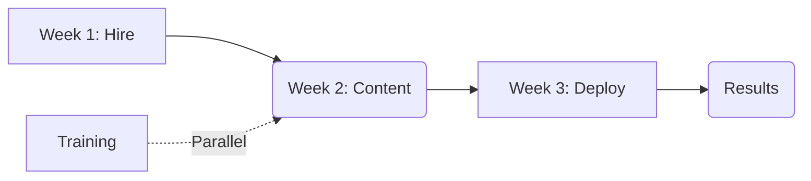

```markdown
---
title: Support Team Review & Proposal
lang: en
layout: cover
---

## Ticket Volume Trend (July - September)

- July tickets: 420
- August tickets: 510 (Growth +21%)
- September tickets: 610 (Growth +19.6%)

::right::
- Total increase: 420 tickets in 3 months.
- Trend indicates unsustainable load for current team size.

```json
{
  "title": "Ticket Volume",
  "tooltip": {},
  "legend": {
    "data": ["Tickets"]
  },
  "xAxis": {
    "type": "category",
    "data": ["July", "August", "September"]
  },
  "yAxis": {
    "type": "value"
  },
  "series": [
    {
      "name": "Tickets",
      "type": "bar",
      "data": [420, 510, 610]
    }
  ]
}
```

<!-- Slide 2: Show the steep growth in ticket volume to justify resource needs. -->
---

## Response Time Degradation

- July average: 4.5 hours
- August average: 9 hours (Doubled)
- September average: 9+ hours

::right::
- Customer satisfaction is directly tied to speed.
- Current wait times are causing frustration and churn risk.

```json
{
  "title": "Response Time",
  "tooltip": {},
  "legend": {
    "data": ["Avg Response Time"]
  },
  "xAxis": {
    "type": "category",
    "data": ["July", "August"]
  },
  "yAxis": {
    "type": "value",
    "min": 0,
    "max": 12
  },
  "series": [
    {
      "name": "Avg Response Time (hours)",
      "type": "line",
      "data": [4.5, 9]
    }
  ]
}
```

<!-- Slide 3: Highlight the critical failure in SLA and customer experience. -->
---

## The Current Bottleneck

- One support person is now handling 610 tickets/month.
- Response time has doubled without new hires or automation.
- Team is at high risk of burnout and missed SLAs.

::right::
- **Statement:** We cannot maintain quality support at this volume with current resources.

```json
{
  "title": "Bottleneck Analysis",
  "tooltip": {},
  "legend": {
    "data": ["Risk Level"]
  },
  "xAxis": {
    "type": "category",
    "data": ["Volume", "Time"]
  },
  "yAxis": {
    "type": "value"
  },
  "series": [
    {
      "name": "Risk",
      "type": "line",
      "data": [10, 8]
    }
  ]
}
```

<!-- Slide 4: Clearly state the problem to align on urgency. -->
---

## Proposed Solution

- **Hire:** One additional support specialist (immediate capacity).
- **Build:** Self-service help page to reduce ticket volume.

::right::
- Reduces load on current team by 30%.
- Improves customer experience through faster answers.

```json
{
  "title": "Solution Overview",
  "tooltip": {},
  "legend": {
    "data": ["Action"]
  },
  "xAxis": {
    "type": "category",
    "data": ["Hire", "Self-Service"]
  },
  "yAxis": {
    "type": "value"
  },
  "series": [
    {
      "name": "Impact",
      "type": "bar",
      "data": [30, 25]
    }
  ]
}
```

<!-- Slide 5: Present the core strategy clearly. -->
---

## Implementation Plan

- Week 1: Interview and hire second support person.
- Week 2: Draft content for self-service help page.
- Week 3: Deploy help page and train staff on new tools.

::right::
- Timeline: 3 weeks to full effect.
- Budget: Hiring + Content creation costs.



<!-- Slide 6: Show the roadmap for approval. -->
---

## Next Steps & Approval

- **Action:** Approve budget for second hire.
- **Action:** Authorize help page content creation.
- **Goal:** Restore response time to < 4 hours by Q1 next year.

::right::
- **Conclusion:** Immediate investment prevents long-term churn and burnout.

```json
{
  "title": "Next Steps",
  "tooltip": {},
  "legend": {
    "data": ["Priority"]
  },
  "xAxis": {
    "type": "category",
    "data": ["Hire", "Page"]
  },
  "yAxis": {
    "type": "value"
  },
  "series": [
    {
      "name": "Priority",
      "type": "bar",
      "data": [10, 8]
    }
  ]
}
```

<!-- Slide 7: Final call to action. -->
---

## Thank You

- Questions?
- Approval requested for budget and timeline.
- Contact: [Your Name]

<!-- End of presentation -->
```markdown
This deck covers the Q3 support metrics, identifies the bottleneck in response time and volume, proposes a hiring and automation solution, outlines the implementation plan, and requests budget approval for Monday's meeting.
```