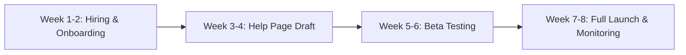

```
---
title: Support Team Update
lang: en
layout: cover
---

# Support Volume & Response Time Review
Monday Team Meeting

<!-- Welcome everyone. Today we'll review our support metrics from the last quarter and propose two concrete steps to stabilize our response times and handle growing demand. -->

---

layout: section
---

# The Current Landscape

<!-- Let's start by looking at what's happening with our support operations over the last three months. -->

---

layout: default
---

## Ticket Volume is Rising
<v-clicks>
- July: 420 tickets
- August: 510 tickets
- September: 610 tickets
</v-clicks>

```echarts
{
  "xAxis": {"type": "category", "data": ["July", "August", "September"]},
  "yAxis": {"type": "value", "name": "Tickets"},
  "tooltip": {"trigger": "axis"},
  "series": [{"data": [420, 510, 610], "type": "bar"}]
}
```

<!-- We've seen a clear upward trend, climbing 45% since July. This growth is outpacing our current capacity and directly impacts our ability to maintain service quality. -->

---

layout: fact
---

# 9 hours
Average first response time has doubled since July.
<v-clicks>
- July baseline: 4.5 hours
- Current average: 9 hours
- Impact: Customer satisfaction and retention at risk
</v-clicks>

<!-- Our response time has doubled, directly impacting customer satisfaction. We need to act before this affects churn or brand trust. -->

---

layout: two-cols
---

## Proposed Solutions
<v-clicks>
- **Hire a second support agent**
- Immediate capacity boost
- Reduces backlog and wait times
</v-clicks>
::right::
<v-clicks>
- **Build a self-service help page**
- Cuts repetitive queries by ~30%
- Scales without headcount growth
</v-clicks>

<!-- To address both capacity and scalability, I propose two parallel tracks: hiring one additional agent to handle immediate volume, and investing in a self-service knowledge base to deflect recurring questions. -->

---

layout: section
---

# Implementation Roadmap

<!-- Here is how we can execute these proposals over the next quarter. -->

---

layout: default
---

## Next Steps & Timeline

<v-clicks>
- Secure budget approval by Friday
- Post job listing immediately
- Assign content owner for help page
- Track metrics weekly post-launch
</v-clicks>

<!-- We can start hiring this week while simultaneously outlining the help page structure. I recommend tracking weekly metrics to measure impact and adjust our approach quickly. -->

---

layout: end
---

# Thank You
Questions & Discussion

<!-- I'm happy to answer any questions about the budget, timeline, or specific metrics. Let's discuss how we can move forward together. -->
```

This 8-slide deck covers the ticket volume surge, the doubled response time, and your two-part proposal (hiring + self-service) with a clear 8-week implementation roadmap, ready for Monday's meeting.