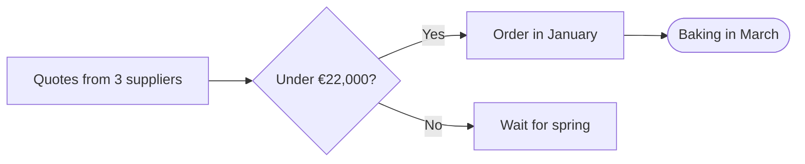

# A second oven

Plan for 2027 · Martin's bakery

<!--
Thank everyone for coming. Two minutes on why, three on the numbers.
-->

---
layout: two-cols
---

## Where we are

<v-clicks>

- **120** croissants a day, sold out by 10
- Queues out of the door on Saturdays
- One oven, already full at 6 am

</v-clicks>

::right::

```echarts
{"title": {"text": "Croissants a day"}, "tooltip": {"trigger": "axis"}, "legend": {"bottom": 0}, "xAxis": {"type": "category", "data": ["Jan", "Feb", "Mar", "Apr", "May", "Jun"]}, "yAxis": {"type": "value"}, "series": [{"name": "Baked", "type": "bar", "data": [96, 104, 110, 118, 120, 120]}, {"name": "Asked for", "type": "line", "data": [100, 115, 130, 142, 150, 161]}]}
```

<!-- We hit the ceiling in May: everything after that is lost sales. -->

---
layout: fact
---

# €21,400

All in: the oven, its fitting and a week closed

---

## What it costs

| | Cost |
|---|---:|
| Oven | €18,000 |
| Fitting | €2,500 |
| A week closed | €900 |
| **In all** | **€21,400** |

---
layout: image-right
image: ./oven.svg
transition: view-transition
---

## Paid back in 14 months

- 40 more croissants a day
- Bread at noon, not just at dawn
- A second baker's shift

---
transition: view-transition
---

## Paid back in 14 months

```echarts
{"title": {"text": "Where the money goes"}, "tooltip": {"trigger": "item"}, "series": [{"type": "pie", "radius": ["40%", "70%"], "data": [{"name": "Oven", "value": 18000}, {"name": "Fitting", "value": 2500}, {"name": "Closed", "value": 900}]}]}
```

---

## The oven we chose


---

## How we decide



---
layout: quote
---

> The queue is the best advert we have, and the worst welcome.

Léa, on Saturdays

---
layout: section
---

# Next steps

---
layout: two-cols-header
---

## Who does what

::left::

### This month

- [x] Three quotes
- [ ] Meet the bank

::right::

### January

- [ ] Order the oven
- [ ] Plan the week closed

::bottom::

Questions to **marie@bakery.example**

---
layout: end
---

# Thank you
