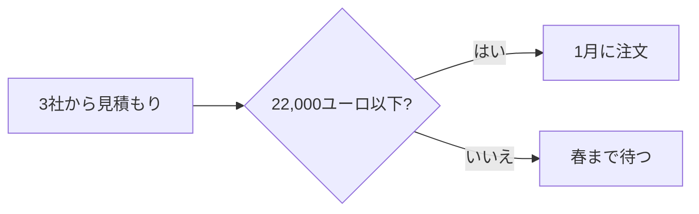

# 二台目のオーブン

2027年の計画 · マルタン・ベーカリー

---
layout: two-cols
---

## 現状

<v-clicks>

- 1日 **120** 個のクロワッサン、10時には完売
- 土曜日は店の外まで行列
- オーブンは1台、朝6時から満杯

</v-clicks>

::right::

```echarts
{"title": {"text": "1日のクロワッサン"}, "legend": {"bottom": 0}, "xAxis": {"type": "category", "data": ["1月", "2月", "3月", "4月", "5月", "6月"]}, "yAxis": {"type": "value"}, "series": [{"name": "焼いた数", "type": "bar", "data": [96, 104, 110, 118, 120, 120]}, {"name": "注文", "type": "line", "data": [100, 115, 130, 142, 150, 161]}]}
```

---
layout: fact
---

# 21,400ユーロ

オーブン、設置、1週間の休業を含む

---

## 決め方



---
layout: end
---

# ありがとうございました
