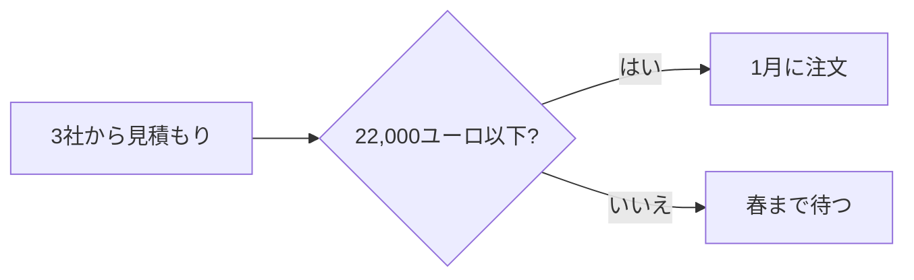

# 二台目のオーブン

2027年の計画 · マルタン・ベーカリー

---
layout: two-cols
---

## 現状

<v-clicks>

- 1日 **120** 個のクロワッサン、10時には完売
- 土曜日は店の外まで行列
- オーブンは1台、朝6時から満杯

</v-clicks>

::right::

```echarts
{"title": {"text": "1日のクロワッサン"}, "legend": {"bottom": 0}, "xAxis": {"type": "category", "data": ["1月", "2月", "3月", "4月", "5月", "6月"]}, "yAxis": {"type": "value"}, "series": [{"name": "焼いた数", "type": "bar", "data": [96, 104, 110, 118, 120, 120]}, {"name": "注文", "type": "line", "data": [100, 115, 130, 142, 150, 161]}]}
```

---
layout: fact
---

# 21,400ユーロ

オーブン、設置、1週間の休業を含む

---

## 決め方



---
layout: mindmap
---

## 二台目で変わること

- 費用
  ```echarts
  {"series": [{"type": "pie", "radius": ["40%", "70%"], "data": [{"name": "オーブン", "value": 18000}, {"name": "設置", "value": 2500}, {"name": "休業", "value": 900}]}]}
  ```
- 朝
  - 昼までクロワッサン
  - 7時の行列がなくなる
- 決め方
  ```mermaid {scale: 0.9}
  flowchart LR
    A[見積もり] --> B[1月に注文]
  ```
- 売上
  ```mermaid
  pie
    "クロワッサン": 120
    "パン": 40
  ```

---
layout: metrics
---

## 一号店の一年

**56%** のお客さまが川の向こうから
**3倍** 2025年より多い注文
**4.8** 1,200件のレビュー

---
layout: agenda
---

## 開店日

- 6:00 最初のパンを窯へ
- 7:00 開店
- 9:30 市長のテープカット
- 12:30 テラスでランチ
- 18:00 ご近所さんと乾杯

---
layout: bento
---

## 新しい店にあるもの

- **テラス** 40席、10時から日当たり良好
  ```echarts
  {"xAxis": {"type": "category", "data": ["5月", "6月", "7月"]}, "yAxis": {"type": "value"}, "series": [{"type": "bar", "data": [30, 42, 55]}]}
  ```
- **大きなオーブン** 1時間に200本
- **キッズコーナー**
- **駐輪場**

---
layout: matrix
---

## 二号店に持っていく商品

### パン

よく売れ、焼きやすい

### クロワッサン

よく売れ、新しいオーブンが必要

### ケーキ

あまり売れず、焼きやすい

### ウェディングケーキ

あまり売れず、パティシエが必要

---
layout: end
---

# ありがとうございました
